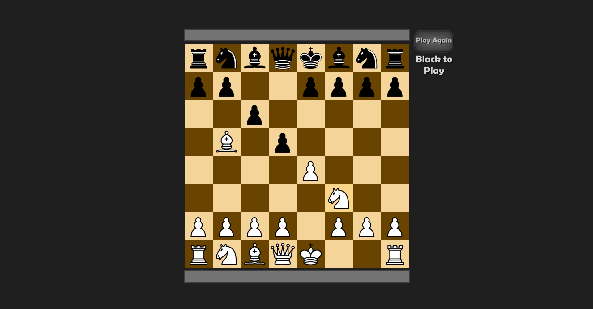

<<<<<<< Updated upstream
# OpenGL Chess

A two-player chess board written in C++17 with modern OpenGL (4.4 core profile), GLFW, GLM, stb_image and Dear ImGui. You move pieces by dragging them with the mouse or by clicking, and a side panel shows whose turn it is and has a button that resets the board.

The project builds on Windows (Visual Studio + CMake) from the `main` branch, and on Linux (Fedora 43 + CMake) from the `Linux` branch.



> **Status:** the board, the pieces, drag-and-drop and turn order work. The game does not check chess rules yet: a piece can move to any square that is empty or holds an enemy piece. Rules are the next milestone (see [Remaining tasks](#remaining-tasks)).

---

## Contents

- [Features so far](#features-so-far)
- [Controls](#controls)
- [Project layout](#project-layout)
- [Dependencies](#dependencies)
- [Building on Windows](#building-on-windows-visual-studio)
- [Building on Linux (Fedora 43)](#building-on-linux-fedora-43)
- [How it works](#how-it-works)
- [Remaining tasks](#remaining-tasks)
- [Housekeeping](#housekeeping)

---

## Features so far

| Area | What works |
| --- | --- |
| Rendering | 8×8 board drawn as 64 scaled copies of one unit quad; 12 PNG piece textures with alpha blending; an aspect-correct orthographic projection, so the board stays square when the window is resized |
| Board state | `Pieces` class holding a 64-square array, loaded from a FEN-style placement string; square lookup with `at(col, row)` |
| Input | Mouse picking that converts window pixels to board squares, including resized and high-DPI windows |
| Drag-and-drop | Press to lift a piece, which follows the cursor drawn on top of the others at 110% size. The target square is highlighted, and releasing drops the piece there. An illegal drop, a drop off the board or a right-click sends the piece back to its square |
| Click-to-move | Click a piece to select it (red square), then click the destination square. Clicking the selected piece again deselects it |
| Turn order | Only the side to move can pick up pieces; the turn passes after each move |
| Captures | Moving onto an enemy piece removes it; moving onto your own piece is refused |
| UI | Dear ImGui panel beside the board showing "White/Black to move" and a **Reset board** button |
| Platforms | Windows (MSVC, prebuilt GLFW) and Linux (GCC, system GLFW) |

## Controls

| Action | Input |
| --- | --- |
| Move a piece | Left-drag it to the target square, **or** click it, then click the target square |
| Cancel a drag | Right-click while dragging, or release outside the board |
| Deselect | Click the selected piece again, or click off the board |
| Reset the game | **Reset board** button in the side panel |
| Quit | `Esc` |

## Project layout

```
OpenGL/
├── CMakeLists.txt          Windows build on main (MSVC + prebuilt GLFW in Dependencies/GLFW);
│                           Linux build on the Linux branch (system GLFW + OpenGL packages)
├── README.md
├── src/
│   ├── main.cpp            Window, render loop, input callbacks, drawing, ImGui panel
│   ├── ChessLogic.h        pieces/colors enums, Pieces board class, FEN decoder, move rules
│   ├── shader.h            Shader loader (compile, link, uniform setters)
│   ├── boardShaders/       bShader.vert / bShader.frag: solid colour per square
│   ├── pieceShaders/       pShader.vert / pShader.frag: textured quad, discards transparent pixels
│   └── ChessPieces/        b-*.png and w-*.png piece images (12 files)
└── Dependencies/
    ├── glad/  KHR/         OpenGL 4.4 core function loader
    ├── GLFW/               Headers + prebuilt Windows libraries (lib-vc2022 is used)
    ├── glm/                Header-only maths library
    ├── stb/                stb_image (PNG loading); stb_image.cpp holds the implementation
    ├── docs/               Screenshot.png used at the top of this README
    └── imGui/imgui-master/ Dear ImGui 1.92.x, with the GLFW and OpenGL3 backends
```

## Dependencies

| Library | Purpose | Windows | Linux |
| --- | --- | --- | --- |
| OpenGL 4.4 core | Rendering | `opengl32` (system) | `mesa-libGL-devel` or your GPU driver |
| GLFW 3.4 | Window, context, mouse and keyboard | Bundled `Dependencies/GLFW/lib-vc2022/glfw3.lib` | `glfw-devel` package |
| GLAD | Loads OpenGL function pointers | Bundled source | Bundled source |
| GLM | Matrices and vectors (`ortho`, `translate`, `inverse`) | Bundled headers | Bundled headers |
| stb_image | Loads the piece PNGs | Bundled header | Bundled header |
| Dear ImGui | Side panel UI | Bundled source | Bundled source |

## Building on Windows (Visual Studio)

1. Open the `OpenGL` folder in Visual Studio with **File → Open → Folder**. Visual Studio detects `CMakeLists.txt`.
2. Select the `x64-Debug` configuration and build (**Build → Build All**).
3. Run `OpenGL.exe`. The build output is in `out/build/x64-Debug/`, and the post-build steps copy `boardShaders/`, `pieceShaders/` and `ChessPieces/` next to the executable.

The root `CMakeLists.txt` currently asks for CMake 4.0 or newer and links the Visual Studio 2022 build of GLFW. `Dependencies/GLFW/include/GLFW` needs both `glfw3.h` and `glfw3native.h`, because the ImGui GLFW backend includes the latter on Windows.

## Building on Linux (Fedora 43)

The Linux build lives on the `Linux` branch. That branch is `main` plus a Linux-specific root `CMakeLists.txt`, which links the system GLFW and OpenGL libraries instead of the Windows `.lib` files. Everything else (GLAD, GLM, stb_image, ImGui) is compiled from `Dependencies/`, the same as on Windows.

```bash
# one-time setup
sudo dnf install cmake gcc-c++ glfw-devel mesa-libGL-devel

# switch to the Linux branch, then configure and build from the project root
git checkout Linux
cmake -S . -B build-linux -DCMAKE_BUILD_TYPE=Debug
cmake --build build-linux -j

# run from the build folder (assets are loaded with relative paths)
cd build-linux
./OpenGL
```
---

## How it works

### Coordinates

- The board covers world coordinates **−0.8 to 0.8** on both axes (`squareSize = 0.2`, `boardStart = −0.8`).
- `makeProjection()` builds an orthographic projection that keeps squares square for any window shape. Drawing and mouse picking both call it, so they always agree.
- **Row 0 is drawn at the bottom.** The board array index is `row * 8 + col`, so index 0 is a1 (bottom-left from White's side) and index 63 is h8.

### Board state and FEN

`Pieces::FENdecoder` fills the array **in string order starting at index 0**. Standard FEN lists rank 8 first, but index 0 is a1, so the game loads `revStart` (`"RNBQKBNR/PPPPPPPP/8/8/8/8/pppppppp/rnbqkbnr"`), the starting position with the ranks reversed. Loading a standard FEN string directly would put Black's pieces on ranks 1–2 and White's on ranks 7–8. Making the decoder read standard FEN is one of the tasks below.

### Game state

```cpp
struct GameState {
    Pieces    board;                     // 64 squares + sideToMove
    DragState drag;                      // active, origin square, lifted piece, cursor (world)
    GLint     selectedCol, selectedRow;  // red highlight / click-to-move origin
    GLint     hoverCol, hoverRow;        // drop-target highlight while dragging
};
```

One `GameState` lives in `main()`. It is registered with `glfwSetWindowUserPointer` so the GLFW callbacks can reach it without global variables. **Reset board** assigns a fresh `GameState` in place, so that pointer stays valid.

### Input flow

1. **Press** on a piece of the side to move: the piece is *lifted*. The board array is not changed; the piece is only hidden on its square.
2. **Cursor moves**: `cursor_pos_callback` updates the lifted piece's world position and the hovered square.
3. **Release** on another square: `Pieces::movePiece()` is called. If the move is refused, nothing changed, so the piece reappears on its original square ("snap back" needs no code of its own).
4. Clicks over the ImGui panel are ignored by the board (`ImGui::GetIO().WantCaptureMouse`).

All rule decisions go through two functions in `ChessLogic.h`, `canPickUp()` and `isMoveAllowed()`. The chess rules below can be added there without touching input or rendering.

### Render order (each frame)

1. Board squares, with selection and drop-target tints (`boardShader`)
2. All pieces except the lifted one (`pieceShader`)
3. The lifted piece at the cursor, drawn last so it is on top
4. The ImGui panel

The loop waits on `glfwWaitEventsTimeout(0.1)`, so the game uses almost no CPU while idle but still gives ImGui the extra frames it needs.

---

## Remaining tasks

The tasks are listed roughly in build order. The move-legality tasks all go into `ChessLogic.h`, mostly inside `isMoveAllowed()`.

### 1. Correct movement for each piece

- [ ] **Pawn:** one square forward onto an empty square; two squares from its starting rank if both squares are empty; diagonal one square only when capturing. Direction depends on colour (White goes up, toward row 7).
- [ ] **Knight:** the eight L-shaped jumps; it jumps over pieces.
- [ ] **Bishop / Rook / Queen:** slide along diagonals, ranks/files, or both. Every square between start and target must be empty.
- [ ] **King:** one square in any direction (plus castling, below).
- [ ] Suggested structure: a `generateMoves(col, row)` function returning a list of target squares. `isMoveAllowed()` then checks whether the target is in that list, and the same list can drive legal-move highlighting.

### 2. Check, checkmate and stalemate

- [ ] `isSquareAttacked(col, row, byColor)`: does any enemy piece reach this square?
- [ ] Reject any move that leaves your own king in check (make the move on a copy of the board, test, discard).
- [ ] After each move: no legal moves and in check means **checkmate**; no legal moves and not in check means **stalemate**.
- [ ] Show the result in the ImGui panel and highlight a king that is in check.

### 3. Castling

- [ ] Track castling rights: four flags (White/Black, king side/queen side), cleared when the king moves, when that rook moves, or when that rook is captured.
- [ ] Allowed only if the squares between king and rook are empty, the king is not in check, and the king does not pass through or land on an attacked square.
- [ ] The king moves two squares. `movePiece()` must also move the rook (h1→f1 / a1→d1 for White, h8→f8 / a8→d8 for Black).
- [ ] Dragging the king two squares should trigger castling. Dropping the king onto its own rook could also be accepted (some games allow this).

### 4. En passant

- [ ] Store an en passant target square after every two-square pawn move (the square the pawn skipped over); clear it after the next move.
- [ ] A pawn may capture diagonally onto that square. The captured pawn is removed from the square *beside* the capturing pawn, not from the target square.
- [ ] The capture must also pass the king-safety check from task 2 (en passant can expose a king along a rank).

### 5. Pawn promotion

- [ ] When a pawn reaches the last rank (row 7 for White, row 0 for Black), replace it with a queen, rook, bishop or knight.
- [ ] Ask with an ImGui modal popup (`ImGui::OpenPopup` / `BeginPopupModal`) showing the four piece images (`ImGui::ImageButton` with the existing textures). While the choice is open, the game waits and the board ignores clicks.
- [ ] A simpler first step: always promote to a queen, then add the popup.

### 6. Render the board from Black's side

- [ ] Add a `bool flipped` to `GameState` and a **Flip board** button or checkbox in the ImGui panel.
- [ ] Keep the board array as it is and flip only the display, with a single mapping used everywhere:
  `displayCol = flipped ? 7 - col : col;  displayRow = flipped ? 7 - row : row;`
- [ ] Apply it in three places: `drawBoard` and `drawPieces` (where squares are drawn) and `worldToSquare` (which converts the mouse back to a board square). The drag code needs no changes.
- [ ] Square colours stay correct automatically, because `(col + row) % 2` does not change under the flip.
- [ ] Optional: flip automatically when a game starts as Black, or after every move for a pass-and-play mode.

### 7. Full FEN support

- [ ] Make `FENdecoder` read standard FEN (rank 8 first) by writing rank `r` into row `7 - r`. Then `startFEN` can be used directly and `revStart` can be removed.
- [ ] Parse the remaining FEN fields: side to move, castling rights, en passant square, half-move clock, full-move number.
- [ ] Add `toFEN()` for saving and loading positions, and add bounds checks so malformed strings cannot write past square 63.

### 8. Draw rules

- [ ] Fifty-move rule (half-move clock reaches 100).
- [ ] Threefold repetition (keep a history of positions, for example FEN strings without the clocks, or Zobrist hashes).
- [ ] Insufficient material (K vs K, K+B vs K, K+N vs K, and same-colour bishops).

### 9. Game experience

- [ ] Show legal target squares (dots or tints) while a piece is dragged or selected.
- [ ] Highlight the last move's origin and target squares.
- [ ] Move list in the ImGui panel using algebraic notation (e4, Nf3, O-O, exd5, e8=Q+).
- [ ] Undo / redo using a move history (store each move plus what it captured and the previous castling/en passant state).
- [ ] Optional: a faded "ghost" piece on the origin square while dragging (add an `alpha` uniform to `pShader.frag`), cancel a drag when the window loses focus (`glfwSetWindowFocusCallback`), captured-piece trays, clocks, a simple computer opponent.

### 10. Testing

- [ ] Perft tests (count all legal moves to a given depth from known positions and compare with published totals) to catch move-generation bugs, especially castling, en passant and promotion.
- [ ] Keep `ChessLogic.h` free of OpenGL so it can be tested in a small console program.

---

## Housekeeping

Small clean-ups, none of which block the tasks above:

- [ ] Stop tracking the Visual Studio build output in `x64/Debug/` (`OpenGL.exe`, `OpenGL.pdb`).
- [ ] Change the shaders from `#version 460 core` to `#version 440 core` to match the OpenGL 4.4 context; drivers that stop at OpenGL 4.5 (common on Linux in virtual machines and on older GPUs) reject 4.60 shaders.
- [ ] Remove or use the leftover `susString` and the declared-but-never-defined `pieceToChar()` in `ChessLogic.h`.
- [ ] Add `build-linux/` and `x64/` to `.gitignore`.
- [ ] Consider merging the Windows and Linux `CMakeLists.txt` into one file with `if(WIN32) … else() … endif()` once the Linux build is confirmed on Fedora, so the `Linux` branch is no longer needed.
- [ ] Load assets relative to the executable's folder instead of the working directory, so the game can be launched from anywhere.
=======
# OpenGL Chess

A two-player chess game written in C++17 with modern OpenGL (4.4 core profile), GLFW, GLM and stb_image. Pieces are moved by dragging them with the mouse or by clicking. All of the user interface (status message, **Play Again** button, captured-piece trays, legal-move dots and the promotion panel) is drawn with OpenGL textures; there is no UI library.

The project builds on Windows (Visual Studio + CMake) from the `main` branch. A `Linux` branch exists but is out of date (see [Building on Linux](#building-on-linux-fedora-43)).


> **Status:** all of the rules of chess are in: every piece's movement, check, checkmate, stalemate, castling, en passant and pawn promotion (with a choice of piece). What is still missing to call the game complete is the set of **draw rules** (insufficient material, fifty-move rule, threefold repetition), plus a few bugs and loose ends listed under [Known issues](#known-issues) and [Still to do](#still-to-do).

---

## Contents

- [Features](#features)
- [Controls](#controls)
- [Project layout](#project-layout)
- [Dependencies](#dependencies)
- [Building on Windows](#building-on-windows-visual-studio)
- [Building on Linux (Fedora 43)](#building-on-linux-fedora-43)
- [How it works](#how-it-works)
- [Known issues](#known-issues)
- [Still to do](#still-to-do)
- [Nice to have](#nice-to-have)
- [Housekeeping](#housekeeping)

---

## Features

| Area | What works |
| --- | --- |
| Rendering | 8×8 board drawn as 64 scaled copies of one unit quad; piece and UI textures with alpha blending; an aspect-correct orthographic projection, so the board stays square when the window is resized. The window keeps redrawing while it is being resized (`glfwSetWindowRefreshCallback`) |
| Board state | `Board` class holding a 64-square array, loaded from a FEN-style placement string; square lookup with `at(col, row)` |
| Movement rules | Per-piece checks for pawn, knight, bishop, rook, queen and king, with sliding pieces blocked by anything in the way |
| Check and checkmate | A move that leaves your own king in check is refused. After every move the game counts the side to move's legal moves and sets the state to **normal**, **check**, **checkmate** or **stalemate** |
| Castling | King side and queen side, for both colours. Refused if the king or that rook has moved, a square in between is occupied, or the king is in check, passes through check or lands in check. The rook is moved automatically |
| En passant | Available for one move after an enemy pawn's two-square advance; the captured pawn is removed from the square beside the capturing pawn |
| Pawn promotion | When a pawn reaches the last rank, a panel beside the board offers a queen, rook, bishop or knight in that pawn's colour. The board is locked until a piece is chosen |
| Legal-move dots | While a piece is selected or dragged, a dot is drawn on every square it can legally move to |
| Drag-and-drop | Press to lift a piece; it follows the cursor at 110% size and is drawn on top. The square under the cursor is highlighted, and releasing drops the piece there. An illegal drop, a drop off the board or a right-click sends the piece back |
| Click-to-move | Click a piece to select it (red square), then click the destination square. Clicking the selected piece again deselects it |
| Highlights | Selected square (red), drop target while dragging (light), and the square the last move landed on (yellow) |
| Captured pieces | Captured pieces appear in a tray above and below the board, sorted from most to least valuable |
| Status message | An image to the right of the board shows *White/Black to play*, *White/Black in check*, the checkmate result, or *Stalemate* |
| Play Again button | Shrinks while pressed, eases back when released, pulses gently while hovered, and resets the game when released over it |
| Idle CPU | The loop sleeps on `glfwWaitEventsTimeout(0.1)` and only polls every frame while a button animation is running |

## Controls

| Action | Input |
| --- | --- |
| Move a piece | Left-drag it to the target square, **or** click it, then click the target square |
| Castle | Move the king two squares toward the rook |
| Capture en passant | Move your pawn diagonally onto the square the enemy pawn skipped over |
| Promote | Move a pawn to the last rank, then click a piece in the promotion panel |
| Cancel a drag | Right-click while dragging, or release outside the board |
| Deselect | Click the selected piece again, or click off the board |
| Reset the game | **Play Again** button |
| Quit | Close the window (`Esc` is not hooked up yet; see [Known issues](#known-issues)) |

## Project layout

```
OpenGL/
├── CMakeLists.txt          Windows build (MSVC + prebuilt GLFW in Dependencies/GLFW)
├── README.md
├── src/
│   ├── main.cpp            Window, render loop, input callbacks, all drawing and UI layout
│   ├── ChessLogic.h        pieces/colors/states enums, Board class, FEN decoder, all chess rules
│   ├── shader.h            Shader loader (compile, link, uniform setters)
│   ├── testing.cpp         Placeholder for console tests of ChessLogic.h (currently empty)
│   ├── boardShaders/       bShader.vert / bShader.frag: solid colour per quad
│   ├── pieceShaders/       pShader.vert / pShader.frag: textured quad, discards transparent pixels
│   ├── ChessPieces/        b-*.png and w-*.png piece images (12 files)
│   └── Icons/              UI images: status messages, PlayAgainButton, MoveDots, PromotionPanel
└── Dependencies/
    ├── glad/  KHR/         OpenGL 4.4 core function loader
    ├── GLFW/               Headers + prebuilt Windows libraries (lib-vc2022 is used)
    ├── glm/                Header-only maths library
    ├── stb/                stb_image (PNG loading); stb_image.cpp holds the implementation
    └── docs/               Screenshot.png used at the top of this README
```

## Dependencies

| Library | Purpose | Windows | Linux |
| --- | --- | --- | --- |
| OpenGL 4.4 core | Rendering | `opengl32` (system) | `mesa-libGL-devel` or your GPU driver |
| GLFW 3.4 | Window, context, mouse and keyboard | Bundled `Dependencies/GLFW/lib-vc2022/glfw3.lib` | `glfw-devel` package |
| GLAD | Loads OpenGL function pointers | Bundled source | Bundled source |
| GLM | Matrices and vectors (`ortho`, `translate`, `scale`, `inverse`) | Bundled headers | Bundled headers |
| stb_image | Loads the PNG textures | Bundled header | Bundled header |

Dear ImGui was used for the side panel in earlier versions and has been removed.

## Building on Windows (Visual Studio)

1. Open the `OpenGL` folder in Visual Studio with **File → Open → Folder**. Visual Studio detects `CMakeLists.txt`.
2. Select the `x64-Debug` configuration and build (**Build → Build All**).
3. Run `OpenGL.exe`. The build output is in `out/build/x64-Debug/`. Post-build steps copy `boardShaders/`, `pieceShaders/`, `ChessPieces/` and `Icons/` next to the executable, and the debugger's working directory is set to that folder, so the relative asset paths resolve.

`CMakeLists.txt` asks for CMake 4.0 or newer and links the Visual Studio 2022 build of GLFW.

## Building on Linux (Fedora 43)

The `Linux` branch holds a Linux-specific `CMakeLists.txt` that links the system GLFW and OpenGL libraries instead of the Windows `.lib` files. **It has not been updated since before check, castling, en passant, promotion and the texture-based UI were added**, so it needs `main` merged into it, and its `CMakeLists.txt` needs:

- the ImGui sources removed (ImGui is no longer in `Dependencies/`),
- `src/testing.cpp` added to the executable, and
- a post-build step that copies `src/Icons` next to the executable.

Once that is done:

```bash
# one-time setup
sudo dnf install cmake gcc-c++ glfw-devel mesa-libGL-devel

git checkout Linux
cmake -S . -B build-linux -DCMAKE_BUILD_TYPE=Debug
cmake --build build-linux -j

# run from the build folder (assets are loaded with relative paths)
cd build-linux
./OpenGL
```

Merging both build files into one with `if(WIN32) … else() … endif()` would remove the need for the branch (see [Housekeeping](#housekeeping)).

---

## How it works

### Coordinates and layout

- The board is `8 × squareSize` (`squareSize = 0.18`) world units wide, centred on the origin, so it covers **−0.72 to 0.72** on both axes (`boardStart = −0.72`).
- `makeProjection()` builds an orthographic projection that keeps squares square for any window shape. Drawing and mouse picking (`cursorToWorld()` then `worldToSquare()`) both use it, so they always agree, including on resized and high-DPI windows.
- **Row 0 is drawn at the bottom.** The board array index is `row * 8 + col`, so index 0 is a1 (bottom-left from White's side) and index 63 is h8. White starts on rows 0–1 and moves **up**; Black starts on rows 6–7 and moves **down**.
- Every UI element's position and size is a named constant at the top of `main.cpp` (tray, button, status message and promotion panel constants).
- Most UI images in `Icons/` are 1920 × 1080 canvases with the artwork in the middle. Their quads are therefore drawn in a 16 : 9 shape (`resetBtnSize`, the move dots at `squareSize * 1.777`). The promotion panel goes one step further: `promoPanelPxMin` / `promoPanelPxMax` record the pixel rectangle the panel occupies inside its canvas, and `drawPromotionTray()` scales and shifts the quad so that exactly that rectangle covers the four piece slots plus `promotionPanelPad`.

### Board state and FEN

`Board::FENdecoder` fills the array **in string order starting at index 0**. Standard FEN lists rank 8 first, but index 0 is a1, so the game loads the starting position with its ranks reversed. The two strings in `main.cpp` are named the other way round from what you might expect:

| Name | Value | Used for |
| --- | --- | --- |
| `startFEN` | `"RNBQKBNR/PPPPPPPP/8/8/8/8/pppppppp/rnbqkbnr"` (ranks reversed) | Loaded at startup and by **Play Again** |
| `revStart` | `"rnbqkbnr/pppppppp/8/8/8/8/PPPPPPPP/RNBQKBNR"` (standard FEN) | Not used |

Uppercase letters are White and lowercase letters are Black. Only the piece-placement field is read.

Besides the 64 squares, `Board` stores:

| Member | Meaning |
| --- | --- |
| `sideToMove` | Whose turn it is |
| `currentGameState` | `NORMAL`, `CHECK`, `CHECKMATE` or `STALEMATE` for the side to move |
| `capturedByWhite`, `capturedByBlack` | Captured pieces, kept sorted by value for the trays |
| `wKingMoved`, `bKingMoved` | Set when that king moves (castling rights) |
| `wRook0Moved` … `bRook7Moved` | Set when anything leaves or lands on that rook's corner (castling rights; see `updateRookFlags()`) |
| `enPassantCol`, `enPassantRow` | Square skipped by the last two-square pawn move, or −1 |
| `promotionPending`, `promoCol`, `promoRow` | A pawn is waiting to be promoted on that square |
| `gameOver` | Set on checkmate or stalemate (not read anywhere yet) |

### Move validation

Every move goes through `Board::movePiece()`, which first calls `isMoveAllowed()`:

1. Reject moves that stay on the same square, pick up an empty square or the wrong colour, or land on your own piece.
2. **King safety:** make the move on a copy of the board (also removing the captured pawn for en passant) and reject it if that side's king is then attacked (`isInCheck()` → `isSquareAttacked()`).
3. Dispatch on the piece type:

| Function | Rule |
| --- | --- |
| `pawnMoveCheck()` | One square forward onto an empty square; two squares from the starting row if both squares are empty; one square diagonally forward when capturing, or onto the en passant square |
| `knightMoveCheck()` | L-shape: 2 + 1 squares in any direction; jumps over pieces |
| `bishopMoveCheck()` | Any distance diagonally; every square in between must be empty |
| `rookMoveCheck()` | Any distance along a rank or file; every square in between must be empty |
| `queenMoveCheck()` | `rookMoveCheck() || bishopMoveCheck()` |
| `kingMoveCheck()` | One square in any direction, or two squares sideways if `canCastle()` allows it |

If `isMoveAllowed()` returns `false`, the board is untouched, so a dragged piece simply reappears on its square.

`generateMoves(col, row)` tries all 64 targets with `isMoveAllowed()` and returns the legal ones. It drives both the legal-move dots and the checkmate/stalemate test.

### Making a move

When the move is allowed, `movePiece()`:

1. Clears the en passant square, then sets a new one if this is a two-square pawn move.
2. Adds any captured piece to the mover's captured list and re-sorts it.
3. Updates the castling flags: `updateRookFlags()` for the from and to squares, and the king flag if the king moved.
4. Moves the piece. For en passant it also removes the pawn beside the target; for castling it also moves the rook to the square the king passed over.
5. Passes the turn.
6. If a pawn reached the last rank, sets `promotionPending`. The board then refuses to let pieces be picked up until `promote(choice)` is called from the promotion panel.
7. Calls `updateGameState()`, which counts the new side's legal moves: none and in check is checkmate, none and not in check is stalemate, otherwise check or normal.

### Game state in `main.cpp`

```cpp
struct GameState {
    Board       board;
    DragState   drag;                        // active, wasSelected, origin square, lifted piece, cursor (world)
    GLint       selectedCol, selectedRow;    // red highlight / click-to-move origin
    GLint       hoverCol, hoverRow;          // drop-target highlight while dragging
    GLint       lastMoveCol, lastMoveRow;    // yellow highlight on the last move's target
    ButtonState resetBtn;                    // hover / pressed / animation times
    ButtonState promoBtns[4];                // one per promotion choice
    GLint       promoHover;
};
```

One `GameState` lives in `main()`. A `RenderContext` (game state, shaders, VAO and texture IDs) is registered with `glfwSetWindowUserPointer`, so the GLFW callbacks can reach everything without global variables. **Play Again** assigns a fresh `GameState` in place (keeping the button's animation state), so that pointer stays valid.

### Input flow

1. **While a promotion is pending**, clicks only go to the promotion panel: pressing a slot marks it pressed, and releasing over the same slot calls `board.promote()`.
2. A press on the **Play Again** button is captured by the button; releasing over it resets the game.
3. **Press** on a piece of the side to move: the piece is *lifted*. The board array is not changed; the piece is only hidden on its square. If another piece was already selected and the press is on an empty or enemy square, that is a click-to-move instead.
4. **Cursor moves:** `cursor_pos_callback` updates the lifted piece's position, the hovered square and the button hover states.
5. **Release** on another square: `movePiece()` is called. If it is refused nothing changed, so the piece reappears on its original square.

### Button animation

`promoScale(button, pulseAmount)` returns the draw scale for both the Play Again button (`resetPulseAmount`, ±2%) and the promotion pieces (`promoPulseAmount`, ±8%):

- held down over the button: `resetBtnPressScale` (92%),
- hovered: `1 + pulseAmount × sin(time × promoPulseSpeed)`,
- just released: eases from 92% back to the resting size over `resetBtnReleaseTime` (0.12 s).

### Render order (each frame)

1. Board squares with selection, drop-target and last-move tints, then the two captured-piece trays (`boardShader`)
2. Captured pieces in the trays (`pieceShader`, as is everything below)
3. Legal-move dots
4. All pieces except the lifted one, then the lifted piece at the cursor
5. Play Again button and status message
6. Promotion panel and its four choices, if a promotion is pending

---

## Known issues

Bugs in the current code, roughly in order of importance.
- [ ] **The Play Again pulse starts at a random point.** `resetBtn.hoverStart` is never set, so the `sin()` pulse starts wherever it happens to be. Set it in `cursor_pos_callback` when the hover begins, the same way the promotion buttons do.
- [ ] **Dots on capture squares are mostly hidden.** The dots are drawn before the pieces, so a dot on a capturable enemy piece is covered by that piece. Draw a ring or a tint for capture squares instead, or draw the dots after the pieces.

Smaller notes:

- `pawnMoveCheck()` decides the pawn's direction from `sideToMove` instead of the pawn's own colour. It works because `isSquareAttacked()` handles pawns itself, but using `at(fromCol, fromRow).currColor` would be safer.
- The `return true;` at the end of `isMoveAllowed()` cannot be reached.
- `updateRookFlags()` and `FENdecoder()` are declared `const void`; `const` does nothing on a `void` return type, so they should be plain `void`.
- `ChessLogic.h` uses `std::abs` without `#include <cstdlib>` and has no `#pragma once`.
- `drawPossibleMoves()` defines a `findMove` lambda that is never used, and `Board::findMove()` takes its vector by value (it should be `const std::vector<Move>&`). `generateMoves()` runs every frame while a piece is selected; it could be computed once when the piece is picked up and stored in `GameState`.

---

## Still to do

What is left to make the game complete, in a suggested order. Rule work goes into `ChessLogic.h`; drawing and input go into `main.cpp`.

#### 1. Draw rules

- [ ] Add a `DRAW` state (or a draw reason) to `states`, and a *Draw* status image, so these are not all reported as *Stalemate*.
- [ ] **Insufficient material:** Extend `justTwoKings()` to K+B vs K, K+N vs K, and K+B vs K+B with both bishops on the same colour square.
- [ ] **Fifty-move rule:** add a half-move clock that is reset by every pawn move and capture and increased by every other move; the game is drawn at 100.
- [ ] **Threefold repetition:** after each move, store a key for the position (the 64 squares, side to move, castling flags and en passant square, for example as a string) and count how often it has occurred. Three times is a draw.

#### 2. End of game

- [ ] Ignore board clicks once `gameOver` is set, until **Play Again**.
- [ ] Optional: tint the king's square red while it is in check, so check is visible on the board as well as in the status message.

#### 3. Small fixes

- [ ] Fix the bugs under [Known issues](#known-issues).
---

## Nice to have

Not needed for a complete game, but useful:

- **Play as Black / flip the board:** a `bool flipped` in `GameState`, mapping `displayCol = flipped ? 7 - col : col` (and the same for rows) in `drawBoard`, `drawPieces`, `drawPossibleMoves` and `worldToSquare`.
- **Last move:** highlight the origin square as well as the target.
- **Move list** in standard algebraic notation (e4, Nf3, O-O, exd5, e8=Q+).
- **Undo / redo:** store each move with what it captured and the previous castling, en passant and clock state.
- **Full FEN support:** make `FENdecoder` read standard FEN (rank 8 first) by writing rank `r` into row `7 - r`, parse the other fields (side to move, castling, en passant, clocks), add `toFEN()`, and bounds-check malformed strings so they cannot write past square 63.
- **Perft tests** in `testing.cpp`: count all legal moves to a given depth from known positions and compare with published totals. This catches castling, en passant and promotion bugs. Keeping `ChessLogic.h` free of OpenGL makes this possible.
- A faded "ghost" piece on the origin square while dragging, cancelling a drag when the window loses focus, sound effects, chess clocks, and a simple computer opponent.

---

## Housekeeping

- [ ] Add `x64/` and `build-linux/` to `.gitignore` (it only lists `out/` and `.vs/`), and stop tracking the old Visual Studio output in `x64/Debug/`.
- [ ] Change `bShader.vert`, `bShader.frag` and `pShader.vert` from `#version 460 core` to `#version 440 core` to match the OpenGL 4.4 context (`pShader.frag` already uses 440). Drivers that stop at OpenGL 4.5, common on Linux virtual machines and older GPUs, reject 4.60 shaders.
- [ ] Crop the images in `Icons/`. Each is a 1920 × 1080 PNG of about 16 MB, mostly transparent, which slows start-up and uses GPU memory. After cropping, the quad sizes in `main.cpp` need to match the new aspect ratios, and the promotion panel's `promoPanelPx*` constants become simply `0,0` to the image size.
- [ ] Merge the Windows and Linux `CMakeLists.txt` into one file with `if(WIN32) … else() … endif()`, so the `Linux` branch is no longer needed.
- [ ] Load assets relative to the executable's folder instead of the working directory, so the game can be launched from anywhere.
- [ ] Sort out the `startFEN` / `revStart` names once `FENdecoder` reads standard FEN.
>>>>>>> Stashed changes
